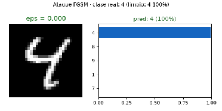
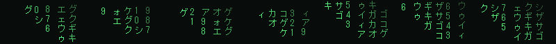

<div align="center">

<a href="https://github.com/raulpuert">
  
</a>

<br/>


</div>

<br/>

### 🎯 What I do

<div align="center">

This is what a **99%-accurate MNIST classifier** looks like after meeting me —
a real adversarial attack, frame by frame:



<sub><i>Same image. Invisible perturbation. Different prediction. My repo generates this live.</i></sub>

</div>

### 🧠 About me

```text
raul@github:~$ whoami
3rd-year CS student from Spain
raul@github:~$ cat focus.txt
▸ adversarial ML & model security
▸ deep learning from first principles
▸ teaching what I learn, in ES + EN
raul@github:~$ python -c "print('hello')"
hello
raul@github:~$ ▌
```

> *"Break it, understand it, defend it."*

<div align="center">
  
</div>

### 🚀 Featured project

<div align="center">

[](https://github.com/raulpuert/adversarial-ml-playground)


</div>

- ⚔️ **Five attacks from scratch**: FGSM · BIM · PGD (L∞/L2) · DeepFool · Carlini–Wagner — each with its math derived in the docs
- 🛡️ **Three real defenses**: Madry-style adversarial training · input transformations · randomized smoothing with **certified L2 radii**
- ✅ **40 tests** verifying the mathematical invariants of every attack, CI-green on Python 3.10 & 3.12
- 📊 **Every number is reproducible** — models trained on CPU, checkpoints included, one script regenerates all results

### 🔭 Now

- 🔨 Building **black-box attacks** (SPSA, Square Attack) for [adversarial-ml-playground](https://github.com/raulpuert/adversarial-ml-playground/issues/1) — the model I trained resists gradients; now I'm learning to attack it without them
- 📖 Reading *Obfuscated Gradients Give a False Sense of Security* (Athalye et al., 2018) — why 7 of 9 ICLR'18 defenses fell
- 🧠 Deepening **C++ and Java** on the side of my ML work

### 🗺️ Roadmap · adversarial-ml-playground

- [ ] Black-box attacks: SPSA & Square Attack — [#1](https://github.com/raulpuert/adversarial-ml-playground/issues/1)
- [ ] Adaptive EOT attacks against stochastic defenses — [#2](https://github.com/raulpuert/adversarial-ml-playground/issues/2)
- [ ] TRADES as a Madry alternative — [#3](https://github.com/raulpuert/adversarial-ml-playground/issues/3)
- [ ] Fashion-MNIST & SVHN datasets — [#4](https://github.com/raulpuert/adversarial-ml-playground/issues/4)
- [ ] Certified L∞ radius via forward-mode smoothing — [#5](https://github.com/raulpuert/adversarial-ml-playground/issues/5)
- [ ] Interactive demo on Hugging Face Spaces — [#6](https://github.com/raulpuert/adversarial-ml-playground/issues/6)
- [ ] English documentation (ES stays first-class) — [#7](https://github.com/raulpuert/adversarial-ml-playground/issues/7)

### 🛠️ Tech stack

<div align="center">
  
</div>

<br/>


<div align="center">
  <sub>Made with 💜 and PyTorch — breaking models responsibly since 2026</sub>
</div>
